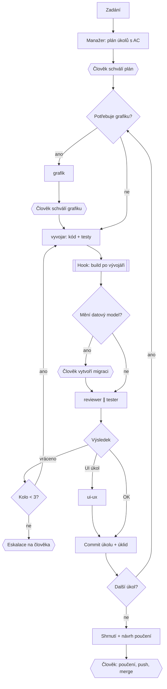

# Agentní vývojová smyčka (`/manager`)

Zadání se rozloží na malé úkoly s akceptačními kritérii. Každý úkol implementuje vývojář, nezávisle ho ověří reviewer a tester a teprve pak se commitne. Manažer kód nečte ani needituje – jen řídí.

Šestiúhelníky jsou lidské brány, dvojitý rámeček je technicky vynucený krok. Úplný seznam bran a způsob vynucení je v [governance/human-in-the-loop.md](../governance/human-in-the-loop.md).

## Role

| Role | Dělá | Nedělá | Model |
|---|---|---|---|
| manažer (`/manager`) | plán, delegace, rozhodnutí, commit, stav | nečte ani needituje kód, nepushuje | hlavní session |
| `vyvojar` | implementace jednoho úkolu včetně testů | necommituje, netvrdí ověření v prohlížeči | Sonnet |
| `reviewer` | review diffu proti pravidlům a pokrytí AC testy | nespouští aplikaci ani build | Opus |
| `tester` | ověří chování proti AC (build, testy, aplikace, prohlížeč) | neposuzuje styl kódu | Sonnet |
| `ui-ux` | použitelnost, konzistence, přístupnost | neověřuje funkčnost | Sonnet |
| `grafik` | SVG, ikony, OG obrázky | nesahá do kódu aplikace | výchozí |

## Postup

1. Sepsat zadání podle [templates/zadani.template.md](../templates/zadani.template.md).
2. U větší změny nejdřív [dual-design.md](dual-design.md).
3. `/manager <cesta k zadání>` – schválit plán, průběžně reagovat na brány.
4. Po přerušení: `/manager <cesta k zadání> pokračuj` – naváže podle `.claude/runs/<slug>/stav.md`.

## Dohledatelnost

Každý běh zanechává stavový soubor `.claude/runs/<slug>/stav.md`: plán, AC, počet kol na úkol, nálezy kontrolorů, commity a rozhodnutí uživatele. Je to zdroj dat pro [metriky](../evidence/metrics.md) a případové studie. Složka je v `.gitignore` – pro doložení ji archivujte do [evidence/case-studies](../evidence/case-studies/).
